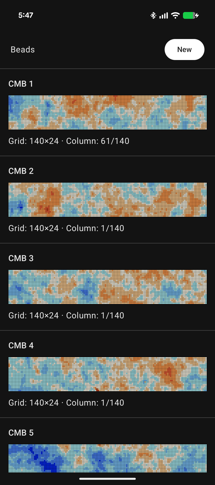
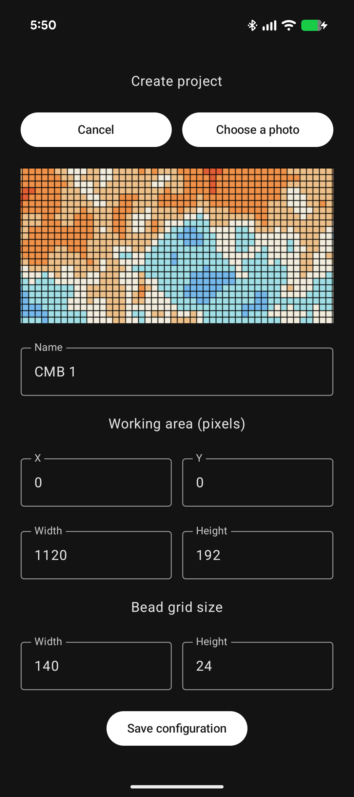
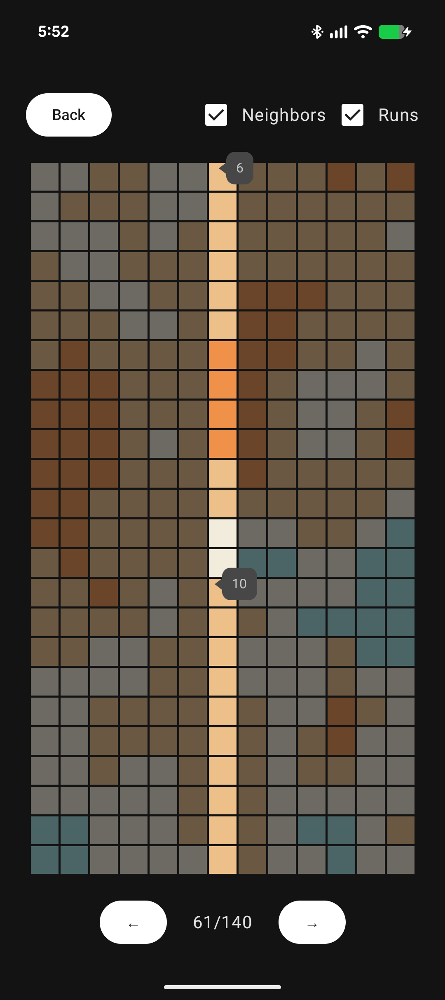

# Beads

A **Beads** egy Android-alkalmazás, amelynek célja, hogy megkönnyítse a részletes, képalapú minták alapján történő gyöngyfűzést.

A projekt a [Data Beads](https://databeads.eu/) kézműves közösségben szerzett tapasztalataimból született. A közösség tagjait az informatika, az adatelemzés és az adatvizualizáció iránti érdeklődés köti össze. Karkötőket és más kézműves tárgyakat készítünk, amelyek mintái különböző adathalmazokat jelenítenek meg.

A részletes minták követésekor a referenciafotó folyamatos nagyítása és mozgatása megnehezíti az aktuális pozíció követését. Könnyű eltéveszteni egy sort vagy oszlopot, ami miatt akár a már elkészült munka egy részét is vissza kell bontani.

A Beads ezt a problémát kezeli: lehetővé teszi egy meglévő mintakép importálását, a munkaterület és a gyöngyrács beállítását, majd a minta oszloponkénti követését.

Az alkalmazás egyik ihletője a kozmikus mikrohullámú háttérsugárzás (CMB) egy részletét megjelenítő saját projektem, amely kilenc színre redukált mintát ábrázol öt nyakkötőn. A nyakkötők ugyanannak a képnek az egymást követő részleteit jelenítik meg.

**Nyelv:** [English](README.md) | Magyar

## Funkciók

### Projektkezelés

- Meglévő mintaképek importálása az Android Photo Picker segítségével.
- Projektek létrehozása név, munkaterület és gyöngyrács-méretek megadásával.
- Az importált képek tárolása az alkalmazás saját, privát tárhelyén.
- A korábban konfigurált projektek megtekintése és újbóli megnyitása.

### Mintakövetés

- A gyöngyminta oszloponkénti követése és a navigáció az oszlopok között.
- Az aktuálisan kiválasztott oszlop gyöngyszíneinek megjelenítése.
- A szomszédos oszlopok opcionális, csökkentett átlátszatlanságú megjelenítése, amely segíti a tájékozódást, miközben az aktuális oszlop marad a középpontban.
- A **Runs** opció bekapcsolásával az aktív oszlopban található, legalább öt egymást követő, azonos színű gyöngyből álló sorozatok hosszának megjelenítése.
- Az aktuális oszlop automatikus megjegyzése projektenként, így az alkalmazás bezárása után a munka ott folytatható, ahol abbamaradt.

### Képfeldolgozás

- A gyöngyszínek mintavételezése a meglévő mintakép konfigurált munkaterületéről.
- Csak a szükséges képrészletek dekódolása a gyöngyszínek beolvasásakor, elkerülve a teljes kép felesleges dekódolását.

## Képernyőképek

| Projektlista | Projekt létrehozása | Mintakövetés |
|---|---|---|
|  |  |  |

## Felhasznált technológiák

- **Programozási nyelv:** Kotlin
- **Felhasználói felület:** Jetpack Compose és Material 3
- **Architektúra:** ViewModel, StateFlow és repository-alapú adatelérés
- **Adattárolás:** Room
- **Aszinkron műveletek:** Kotlin Coroutines
- **Navigáció:** Navigation Compose
- **Képválasztás:** Android Photo Picker
- **Képfeldolgozás:** Android BitmapRegionDecoder
- **Tesztelés:** JUnit és Android instrumentációs tesztek

## A projekt fordítása

Nyisd meg a projektet Android Studióban, telepített Android SDK-val.

Alternatív megoldásként a debug APK parancssorból is elkészíthető:

```bash
./gradlew assembleDebug
```

Windows alatt:

```powershell
.\gradlew.bat assembleDebug
```

Az alkalmazás Android 7.0 (API 24) vagy újabb rendszert igényel.

## A projekt állapota

A Beads egy személyes projekt, amelyet valós gyöngyfűzési feladatok támogatására, valamint a modern Android-fejlesztési megoldások gyakorlati alkalmazására készítek.

Az alkalmazás fejlesztése jelenleg is folyamatban van.