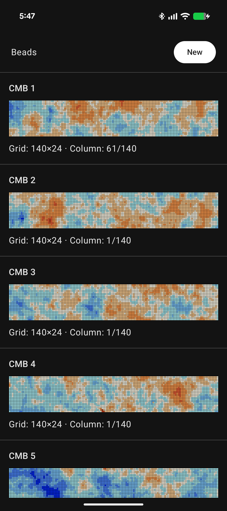
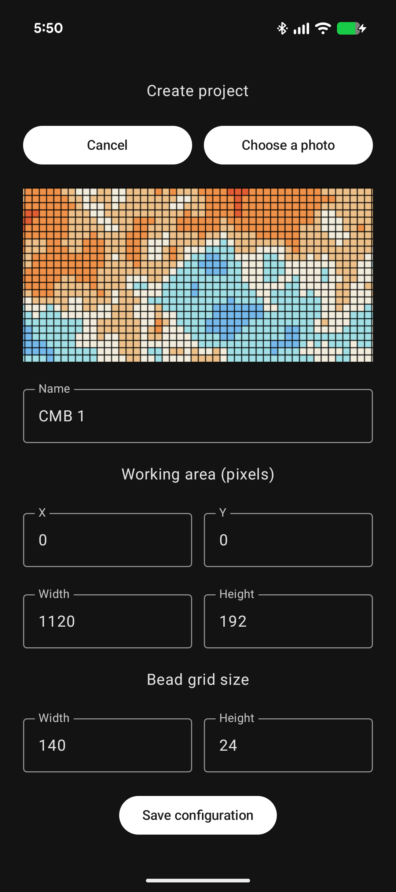
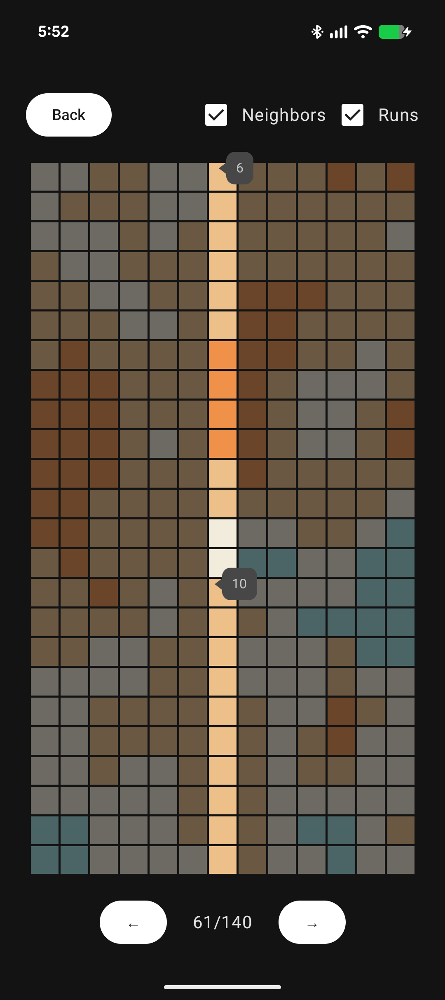

# Beads

**Beads** is an Android application designed to make beadwork easier when following complex, image-based patterns.

The project grew out of my involvement with [Data Beads](https://databeads.eu/), a craft community bringing together people interested in computing, data analysis, and data visualization. We create bracelets and other handmade objects whose patterns represent data.

When working with detailed patterns, constantly zooming and navigating around a reference image makes it easy to lose track of the current position. A small mistake can mean undoing part of the beadwork.

Beads addresses this problem by letting users import an existing pattern image, configure a working area and bead grid, and follow the pattern column by column.

One of the projects that motivated the app is my visualization of a section of the cosmic microwave background (CMB), reduced to nine colors and represented across five neckties, each displaying a consecutive segment of the same image.

**Language:** English | [Magyar](README.hu.md)

## Features

### Project management

- Import existing pattern images using the Android Photo Picker.
- Create projects with a name, working area, and bead grid dimensions.
- Keep imported images in app-private storage.
- View and reopen previously configured projects.

### Pattern navigation

- Navigate through the bead pattern one column at a time.
- Display the bead colors of the currently selected column.
- Optionally show neighboring columns with reduced opacity to provide context while keeping the current column in focus.
- Enable **Runs** to display the length of consecutive, same-colored bead sequences of five or more beads in the active column.
- Automatically remember the current column for each project, allowing users to resume their work where they left off.

### Image processing

- Sample bead colors from the configured working area of an existing pattern image.
- Decode only the required image regions when reading bead colors, avoiding unnecessary full-image decoding.

## Screenshots

| Project list | Create project | Working view |
|---|---|---|
|  |  |  |

## Tech stack

- **Language:** Kotlin
- **UI:** Jetpack Compose and Material 3
- **Architecture:** ViewModel, StateFlow, and repository-based data access
- **Persistence:** Room
- **Asynchronous operations:** Kotlin Coroutines
- **Navigation:** Navigation Compose
- **Image selection:** Android Photo Picker
- **Image processing:** Android BitmapRegionDecoder
- **Testing:** JUnit and Android instrumentation tests

## Building the project

Open the project in Android Studio with an installed Android SDK.

Alternatively, build the debug APK from the command line:

```bash
./gradlew assembleDebug
```

On Windows:

```powershell
.\gradlew.bat assembleDebug
```

The application requires Android 7.0 (API 24) or newer.

## Project status

Beads is a personal project developed to support real beadwork and to explore modern Android development practices.

The application is under active development.